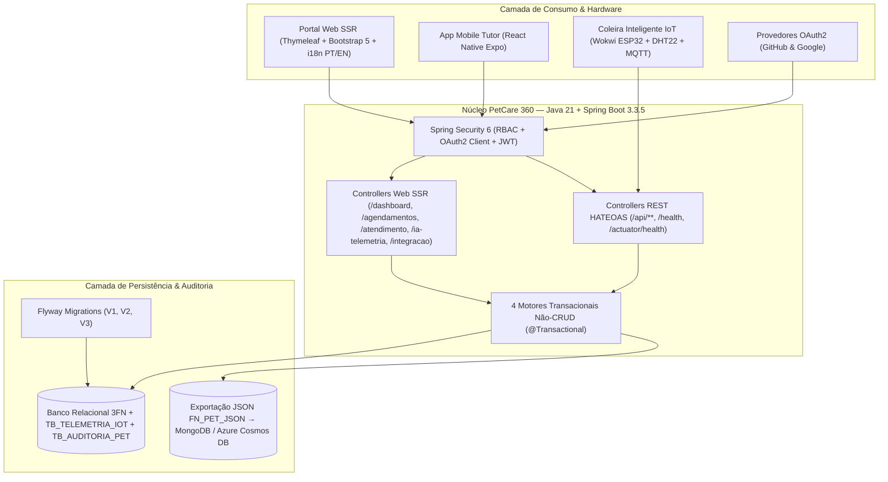

# 🐾 PetCare 360 — Plataforma Veterinária Preventiva (CLYVO VET)

### FIAP — Challenge 2026 | 4ª Sprint (Entrega Final) — Java Advanced
**Turma:** 2TDSPW | **Professor:** Leonardo Real (`lgsreal`)

---

## 👨‍💻 Integrantes do Grupo (2TDSPW)

| Nome Completo | RM | Responsabilidade Técnica Principal na Sprint 4 |
|---|---|---|
| **João Vitor Lacerda Consorte** | **RM 565565** | Arquitetura Core, Spring Security 6, **OAuth2 (GitHub & Google)** e **Internacionalização (`i18n` PT-BR/EN)** |
| **Kauan Vieira de Lima** | **RM 565403** | Integração **IoT & IA Híbrida** (`CopilotoIaTelemetriaService`, Score IRP 0–100, Prontuário Clínico SOAP e Alertas ESP32) |
| **Murillo Fernandes Carapia** | **RM 564969** | Governança **Flyway V3**, Motor Híbrido Relacional→NoSQL (`FN_PET_JSON`), Auditoria (`TB_AUDITORIA_PET`) e Deploy Cloud/Docker |
| **Pedro de Matos Previtali** | **RM 564184** | Fluxos Transacionais (Triagem Preventiva e Atendimento Clínico), UI/UX Thymeleaf, ADRs e Suíte de Testes Automatizados (JUnit 5/MockMvc) |

> 📄 Veja o detalhamento completo das contribuições e commits em [`documentos/colaboracao-equipe.md`](documentos/colaboracao-equipe.md).

---

## 🌐 Links Oficiais da Entrega (Deploy Online, Vídeo e Ecossistema)

| Recurso | Link de Acesso |
|---|---|
| 🚀 **Aplicação Online (Deploy Cloud — Sprint 4 Java)** | [`https://ac61307b65009b.lhr.life/login`](https://ac61307b65009b.lhr.life/login) \| [Deploy 1-Click no Render Cloud (`render.yaml`)](https://render.com/deploy?repo=https://github.com/joaolacerdaconsorte/challenge-sprint-4-java) |
| 📦 **Repositório Oficial GitHub (Sprint 4 Java Advanced)** | [`https://github.com/joaolacerdaconsorte/challenge-sprint-4-java`](https://github.com/joaolacerdaconsorte/challenge-sprint-4-java) |
| ☁️ **Ecossistema Cloud Integrado (Azure Web App — DevOps & .NET)** | [`https://petcare360-rm564969.azurewebsites.net/health`](https://petcare360-rm564969.azurewebsites.net/health) |
| 🔌 **Simulador Hardware Coleira Inteligente (Wokwi ESP32 + DHT22)** | [`https://wokwi.com/projects/464135788106122241`](https://wokwi.com/projects/464135788106122241) |
| 📱 **Repositório Mobile React Native (Nota 100/100)** | [`https://github.com/FIAP-MOBILE-2026-Fevereiro/2tdspw-challenge-joaorm565565-murillo564969-kauan`](https://github.com/FIAP-MOBILE-2026-Fevereiro/2tdspw-challenge-joaorm565565-murillo564969-kauan) |
| ⚙️ **Repositório DevOps & Cloud Azure (Sprint 4)** | [`https://github.com/MurilloFernandesCarapia/Challenge-Devops-Sprint4`](https://github.com/MurilloFernandesCarapia/Challenge-Devops-Sprint4) |
| 🤖 **Repositório IoT & IA Híbrida (ESP32 + Random Forest IRP)** | [`https://github.com/joaolacerdaconsorte/clyvo-vet-iot-sprint3`](https://github.com/joaolacerdaconsorte/clyvo-vet-iot-sprint3) |
| 🎬 **Vídeo de Apresentação (Até 15 min — Todos os 4 Integrantes)** | *(Inserir Link do YouTube Não Listado Aqui)* — Roteiro em [`documentos/roteiro-video-15min.md`](documentos/roteiro-video-15min.md) |

---

## 🎯 Evolução da Sprint 3 para a Sprint 4 (Resolução 100% do Feedback Oficial)

Na Sprint 3, o projeto recebeu nota **80/100** com o seguinte feedback oficial do Prof. Leonardo Real:
> *"Entrega muito completa e bem documentada. O frontend tem cerca de 20 templates Thymeleaf com Bootstrap 5, fragments reutilizáveis, dashboard e páginas de erro customizadas. A segurança implementa três perfis (ADMIN, VETERINARIO, USER) com formLogin em página customizada, proteção granular de rotas e DaoAuthenticationProvider. Os dois fluxos não-CRUD são bem modelados e transacionais: triagem preventiva com agendamento inteligente e atendimento clínico integrado. O documento de entrega é bom, com credenciais de demonstração dos três perfis e instruções de execução. **O que faltou para nota máxima? Adicionar OAuth2 com login de terceiros (Google e/ou GitHub) à página de login.**"*

### O que foi adicionado e aprimorado na Sprint 4:
1. ✅ **Login Social OAuth2 com GitHub e Google (`spring-boot-starter-oauth2-client`):**
   - Configuração completa em `SecurityConfig.java` (`.oauth2Login(...)`) e `application.yml` para **GitHub** (`/oauth2/authorization/github`) e **Google** (`/oauth2/authorization/google`).
   - Serviço [`CustomOAuth2UserService`](src/main/java/br/com/fiap/pet360/security/CustomOAuth2UserService.java) que provisiona e sincroniza automaticamente o usuário autenticado via OAuth2 na tabela `TB_USUARIO` (`OAUTH_PROVIDER` e `EMAIL`).
   - Botões estilizados **"Continuar com GitHub"** e **"Continuar com Google"** na página `/login`, acompanhados de um **Modo Avaliador OAuth2 Sandbox (`/oauth2/sandbox/github` e `/oauth2/sandbox/google`)** para testes instantâneos em ambiente local sem necessidade de chaves externas.
2. ✅ **Internacionalização Nativa (`i18n` PT-BR & EN):**
   - Classe [`InternacionalizacaoConfig`](src/main/java/br/com/fiap/pet360/config/InternacionalizacaoConfig.java) com `SessionLocaleResolver` (`pt_BR` padrão), `LocaleChangeInterceptor` (`?lang=pt_BR` / `?lang=en`) e `ResourceBundleMessageSource` (`i18n/messages`), com seletor de idiomas em todas as páginas.
3. ✅ **Fluxo Não-CRUD 3 — Copiloto Clínico IA Híbrida & Telemetria IoT (`/ia-telemetria`):**
   - Integração direta com a coleira inteligente ESP32 (DHT22 + Acelerômetro IOB): calcula o **Índice de Risco Preventivo (Score IRP 0–100)**, gera o prontuário estruturado **SOAP (`[S]`, `[O]`, `[A]`, `[P]`)**, a recomendação empática ao tutor e dispara alertas automáticos de hipertermia/letargia.
4. ✅ **Fluxo Não-CRUD 4 — Hub de Integração Multidisciplinar (`/integracao`):**
   - Implementação em Java das funções equivalentes ao pacote Oracle PL/SQL `PKG_CLYVO_VET` (`FN_PET_JSON` e `FN_CALC_RISCO_VACINAL`) para exportação de documentos JSON NoSQL (MongoDB / Azure Cosmos DB) e trilha de auditoria automática em `TB_AUDITORIA_PET` (equivalente à trigger `TRG_AUDITORIA_PET`).
5. ✅ **Deploy Cloud-Native & Observabilidade:**
   - `Dockerfile` Multi-Stage com JDK/JRE 21 Alpine e usuário **non-root (`appuser`)**, `render.yaml`, `docker-compose.yml` e endpoints `/health` e `/actuator/health`.

---

## 🏛️ Narrativa da Solução e Decisões Arquiteturais (ADRs — 20 pts)

Todas as escolhas arquiteturais, padrões de projeto e justificativas técnicas estão formalizadas em **Architecture Decision Records (ADRs)** na pasta [`documentos/adr/`](documentos/adr/):

- [**ADR-001:** Arquitetura Híbrida Spring MVC (Thymeleaf SSR) + API RESTful (HATEOAS & OpenAPI)](documentos/adr/ADR-001-arquitetura-hibrida-mvc-rest.md)
- [**ADR-002:** Segurança Unificada com Spring Security 6, RBAC, OAuth2 (GitHub & Google) e JWT](documentos/adr/ADR-002-seguranca-rbac-oauth2-jwt.md)
- [**ADR-003:** Governança de Schema e Evolução de Banco de Dados com Flyway (V1, V2 e V3)](documentos/adr/ADR-003-governanca-schema-flyway.md)
- [**ADR-004:** Motores Transacionais Não-CRUD (Triagem, Atendimento Clínico, Copiloto IA/IoT e Hub NoSQL)](documentos/adr/ADR-004-fluxos-transacionais-nao-crud.md)
- [**ADR-005:** Internacionalização Nativa (`i18n` PT-BR & EN) com `SessionLocaleResolver`](documentos/adr/ADR-005-internacionalizacao-i18n.md)
- [**ADR-006:** Containerização Multi-Stage Non-Root e Deploy em Nuvem (Render / Azure / Docker)](documentos/adr/ADR-006-deploy-cloud-containerizacao.md)



---

## 🔗 Integração Multidisciplinar Explícita (20 pts)

> 📄 Documentação detalhada disponível em [`documentos/integracao-disciplinas.md`](documentos/integracao-disciplinas.md).

| Disciplina FIAP (2TDSPW) | Artefato / Entrega da Equipe | Como está Integrado no Código Java Advanced (Sprint 4) |
|---|---|---|
| **Mastering Relational and Non-Relational Database** *(Nota 95/100)* | Pacote Oracle PL/SQL `PKG_CLYVO_VET` (`FN_PET_JSON`, `FN_CALC_RISCO_VACINAL`, `TRG_AUDITORIA_PET`) + MongoDB | Serviço [`IntegracaoMultidisciplinarService`](src/main/java/br/com/fiap/pet360/service/IntegracaoMultidisciplinarService.java) e tela `/integracao` geram o documento JSON idêntico à `FN_PET_JSON`, calculam o risco vacinal e gravam auditoria automática em `TB_AUDITORIA_PET` a cada `INSERT`/`UPDATE`/`DELETE` em `PetService` e `AtendimentoClinicoService`. |
| **Disruptive Architectures: IoT, IoB & Generative AI** | Coleira ESP32 Wokwi (DHT22 + IOB via MQTT) + Modelo Random Forest IRP (93,4%) + Copiloto Clínico SOAP | Serviço [`CopilotoIaTelemetriaService`](src/main/java/br/com/fiap/pet360/service/CopilotoIaTelemetriaService.java) e tela `/ia-telemetria` processam leituras fisiológicas, calculam o **Score IRP (0–100)**, geram o laudo estruturado **SOAP (`[S]`, `[O]`, `[A]`, `[P]`)** e criam alertas automáticos de hipertermia (`> 39.4 °C`). |
| **Mobile Application Development** *(Nota 100/100)* | App React Native + Expo + TypeScript (Carteira Vacinal, Agenda e Alertas) | Consumo dos endpoints RESTful (`/auth/login`, `/api/pets`, `/api/agendamentos`, `/api/alertas`, `/api/integracao/pets/{id}/json`) com **JWT** e **HATEOAS**. |
| **DevOps Tools & Cloud Computing + .NET** | Pipeline CI/CD Azure DevOps, Docker Non-Root e Deploy Azure Web App + Cosmos DB | `Dockerfile` Multi-Stage com JRE 21 Alpine non-root (`appuser`), `render.yaml`, `/health`, `/actuator/health` e integração direta no Hub `/integracao` com `https://petcare360-rm564969.azurewebsites.net/health`. |
| **Quality Assurance (QA), Compliance & Tests** | Azure Boards (4 Épicos, 11 PBIs escritos em BDD Gherkin) + TOGAF | Suíte [`PetCare360Sprint3ApplicationTests`](src/test/java/br/com/fiap/pet360/PetCare360Sprint3ApplicationTests.java) com **11 testes automatizados JUnit 5 + MockMvc** validando segurança, OAuth2, i18n, RBAC e todos os 4 fluxos não-CRUD. |

---

## 🔐 Credenciais de Demonstração (RBAC + OAuth2)

A migration Flyway `V2` e `V3` popula automaticamente os seguintes usuários para avaliação imediata em `/login`:

| Perfil (Role) | Usuário | Senha | Permissões no Sistema |
|---|---|---|---|
| **ADMIN** | `admin` | `admin123` | Acesso total, incluindo cadastro/edição/exclusão de Clínicas (`/clinicas/nova`), Pets, Tutores, Fila Clínica, Copiloto IA e Hub Multidisciplinar. |
| **VETERINARIO** | `veterinario` | `vet123` | Acesso à Fila de Atendimento Clínico (`/atendimento/fila`), Prontuários, Copiloto IA SOAP (`/ia-telemetria`) e Triagem. |
| **USER (Tutor)** | `tutor` | `tutor123` | Acesso ao Dashboard, Meus Pets, Triagem & Agendamento (`/agendamentos/novo`), Alertas e Telemetria IoT. Bloqueado (`403 Forbidden`) em rotas administrativas e fila clínica. |
| **OAUTH2 (GitHub / Google)** | Botões na tela `/login` | *Login Social / Sandbox* | Autenticação federada via `/oauth2/authorization/github` ou `/oauth2/authorization/google` (ou teste instantâneo via `/oauth2/sandbox/github` e `/oauth2/sandbox/google`). |

---

## 🚀 Como Executar o Projeto (Local ou Docker)

### Opção 1 — Via Gradle Wrapper (JDK 21 LTS)
```bash
# Windows (PowerShell / CMD)
.\gradlew.bat bootRun

# Linux / macOS
./gradlew bootRun
```
- **Interface Web (Login):** [`http://localhost:8080/login`](http://localhost:8080/login)
- **Swagger UI (API REST):** [`http://localhost:8080/swagger-ui.html`](http://localhost:8080/swagger-ui.html)
- **Health Check:** [`http://localhost:8080/health`](http://localhost:8080/health) e [`http://localhost:8080/actuator/health`](http://localhost:8080/actuator/health)

### Opção 2 — Via Docker Compose (Container Multi-Stage Non-Root)
```bash
docker compose up --build -d
```

### Executando os 11 Testes Automatizados (JUnit 5 + MockMvc)
```bash
.\gradlew.bat test
```
*(Resultado esperado: `11 tests completed, 0 failed — BUILD SUCCESSFUL`)*
